Фуллстек: React, Node, FastAPI, Go. Иногда ML. Сейчас пишу **holdfast**, предохранитель для ИИ-агентов на Go: хук для Claude Code, который не даёт агенту сделать `rm -rf ~`, `git push --force` или `curl | sh`, а обычные правки пропускает со снапшотом.

| проект | что это | стек |
|---|---|---|
| Qairu | клуб настольного тенниса: запись на игры, роли, рейтинг Elo | React, TS, Node, Neon |
| [EmoCam](https://github.com/roma2246/FACE_Detect) | эмоции по веб-камере, модель работает в браузере | PyTorch, ONNX, React |
| ARTSPACE | сайт арт-клуба с 3D и загрузкой работ | React, three.js, Express |
| QAIRU karta | 3D-карта учебного корпуса | react-three-fiber |
| LOOKI | стилист: гардероб, чат, удаление фона прямо в браузере | React, transformers.js |

Ещё: IELTS Helper, [Vibe_wear](https://github.com/roma2246/Vibe_wear), [StudyMate](https://github.com/roma2246/StudyMate), [карта на Flutter](https://github.com/roma2246/map_front), Go в tomorrow school.

### Гости

<!-- guests:start -->
пока никого
<!-- guests:end -->

<a href="https://github.com/roma2246/roma2246/issues/new?title=%F0%9F%91%8B&body=%D0%9D%D0%B8%D1%87%D0%B5%D0%B3%D0%BE%20%D0%BF%D0%B8%D1%81%D0%B0%D1%82%D1%8C%20%D0%BD%D0%B5%20%D0%BD%D1%83%D0%B6%D0%BD%D0%BE%2C%20%D0%BF%D1%80%D0%BE%D1%81%D1%82%D0%BE%20%D0%BD%D0%B0%D0%B6%D0%BC%D0%B8%20Create.">Оставь след</a>: создаёшь issue в один клик, и через минуту твоя аватарка появляется здесь. График выше и этот список обновляют <a href=".github/workflows">GitHub Actions</a>.
