<picture>
  <source media="(prefers-color-scheme: dark)" srcset="assets/header-dark.svg">
  
</picture>

Делаю фуллстек: фронт на React, бэк на Node, FastAPI или Go. Часто на хакатонах, иногда с ML.

### Сейчас

**holdfast** `Go`
Линтер инструкций и предохранитель для ИИ-агентов (Claude Code, Cursor, Codex). Встаёт в Claude Code как PreToolUse-хук: необратимое вроде `rm -rf ~`, `git push --force` или `curl | sh` запрещает и подсказывает, как правильно; обратимое пропускает и делает снапшот. Правила из `CLAUDE.md` превращает в проверяемые. Один статический бинарник, хук отвечает примерно за 50 мкс. Репозиторий пока закрыт.

### Хакатоны

| | что сделали | моя часть | стек |
|---|---|---|---|
| **decentraton 6.0** · SetWW | ускорили LoRA-обучение на Kaggle T4: 85 → 56 с, пик памяти 14.3 → 2.3 ГБ, 10 из 10 проверок | ядра RMSNorm на Triton, ревью замеров | PyTorch, Triton |
| **Freedom Broker** · [CQA](https://github.com/roma2246/cqa_Dataton_arasaka) | оценка качества чатов операторов на RU/KZ/EN: чек-лист, доказательства по репликам, апелляции | по README команды: «делал всё» | FastAPI, Postgres, Claude API, React |
| **ForteBank Datathon 26** · [кассы](https://github.com/AGGIB/datathon26) | по видео работы кассира находит нарушения, таймкоды, кадры и пункт НПА | фронтенд | React, TypeScript, FastAPI, Docker |
| **ICT** · [EmoCam](https://github.com/roma2246/FACE_Detect) | эмоции по веб-камере прямо в браузере | всё: обучение модели, бэк, фронт | PyTorch → ONNX, onnxruntime-web, MediaPipe, React |

### Проекты

- **Budget IMFIS**: система бюджетирования. Заявки, расчётные формы, согласование закупок, классификатор НКТ/ОКТРУ, выгрузки в Excel. `React` `Recharts` `Express` `Postgres` `Docker`
- **Qairu**: платформа клуба настольного тенниса. Аккаунты, роли, мероприятия, запись с лимитами, рейтинг Elo. `React 19` `TypeScript` `Node` `Neon`
- **[MedAI](https://github.com/roma2246/MedAI)**: кабинет пациента. Загружаешь анализы в PDF, текст достаётся через OCR, разбор делает Vertex AI, есть Telegram-бот. `React` `MUI` `Express` `Docker`
- **ARTSPACE**: сайт арт-клуба с 3D на three.js и загрузкой работ в S3. Промо-ролик к нему со звуком, который синтезирован с нуля на numpy. `React` `three.js` `Express` `Postgres`
- **QAIRU karta**: 3D-карта учебного корпуса по векторным планам этажей. `react-three-fiber` `zustand`
- **LOOKI**: персональный стилист. Гардероб, чат, удаление фона и модели прямо в браузере. `React 19` `transformers.js` `Express`

<details>
<summary>ещё</summary>
<br>

- **IELTS Helper**: подготовка к IELTS с Gemini. `React` `Express` `SQLite`
- **[Vibe_wear](https://github.com/roma2246/Vibe_wear)**: фронт магазина одежды. `React` `Tailwind` `framer-motion`
- **[StudyMate](https://github.com/roma2246/StudyMate)** + [бэк на Java](https://github.com/roma2246/StudyMate_back)
- **[map_front](https://github.com/roma2246/map_front)** + [map_back](https://github.com/roma2246/map_back): карта на Flutter
- **Go**: piscine в tomorrow school, REST API на chi + pgx

</details>

### Стек

```
языки    TypeScript, JavaScript, Python, Go, SQL; немного Dart и Java
фронт    React, Vite, Tailwind, three.js / react-three-fiber, framer-motion, MUI
бэк      Node + Express, FastAPI, Go (chi, pgx), PostgreSQL / Neon, Supabase, SQLite
ml       PyTorch, Triton, ONNX, MediaPipe, transformers.js
llm      Claude, Gemini, Vertex AI
прочее   Docker, GitHub Actions, Kaggle
```

### Статус

<picture>
  <source media="(prefers-color-scheme: dark)" srcset="assets/status-dark.svg">
  
</picture>

<sub>Настоящие коммиты за 45 дней, без названий репозиториев и сообщений. Обновляет <a href="scripts/status.py">скрипт</a> раз в сутки.</sub>
