<div align="center">


<br/>


</div>

```http
HTTP/1.1 500 Internal Human Error
Retry-After: 1 coffee
X-Reason: ушёл на хакатон
```

> Не волнуйся, это нормальное состояние. Подожди 5 секунд — сервер поднимется 👆

---

### `$ tail -f /var/log/ramazan.log`



### `GET /status`


### `GET /stack`

<p>
  
  
  
  
  
  
  
</p>

### `GET /projects`

| status | эндпоинт | что внутри |
|:---:|---|---|
| `200` | [**MedAI**](https://github.com/roma2246/MedAI) | AI для медицины |
| `200` | [**StudyMate**](https://github.com/roma2246/StudyMate) · [back](https://github.com/roma2246/StudyMate_back) | помощник для учёбы |
| `200` | [**Vibe_wear**](https://github.com/roma2246/Vibe_wear) | магазин одежды с вайбом |
| `200` | [**FACE_Detect**](https://github.com/roma2246/FACE_Detect) | распознавание лиц |
| `200` | [**map_front**](https://github.com/roma2246/map_front) · [back](https://github.com/roma2246/map_back) | карта на Flutter |
| `202` | **следующий проект** | `Accepted` — уже в голове, ещё не в git |

<details>
<summary><code>GET /admin</code></summary>

<br/>

```http
HTTP/1.1 403 Forbidden

Хорошая попытка 😏
Но раз ты дошёл досюда — напиши мне, сделаем что-нибудь вместе.
```

</details>

---

<div align="center">
<sub><code>// если ты это читаешь — сервер в порядке. наверное.</code></sub>
</div>
